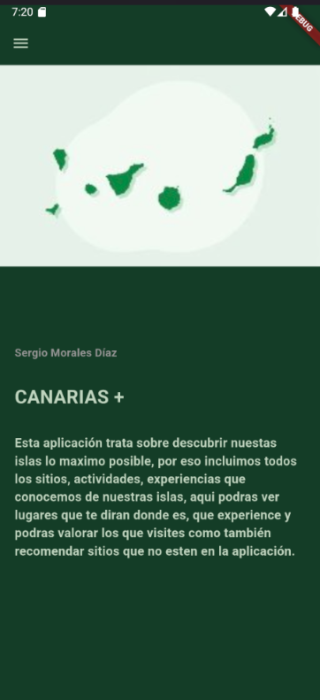
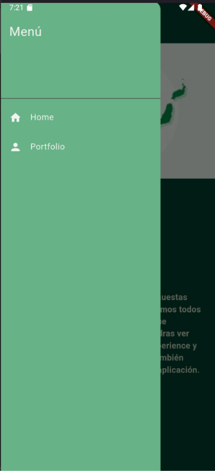
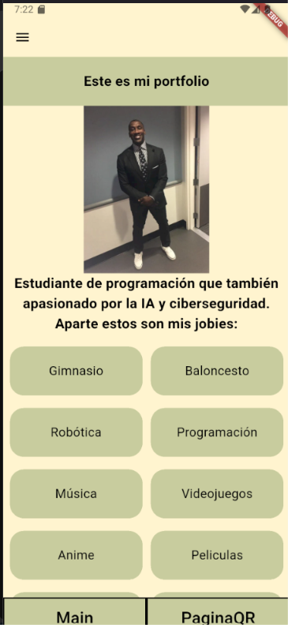
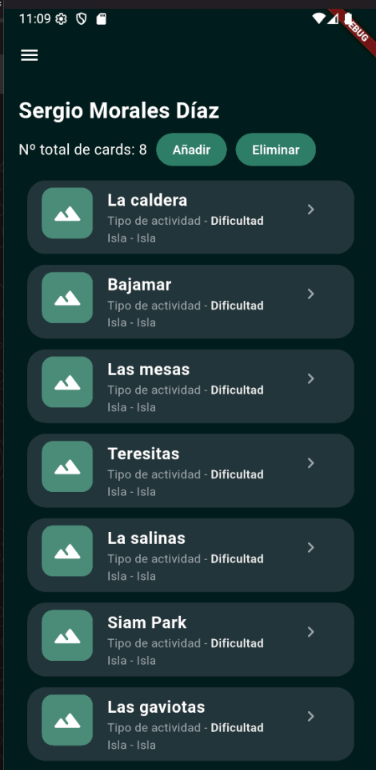
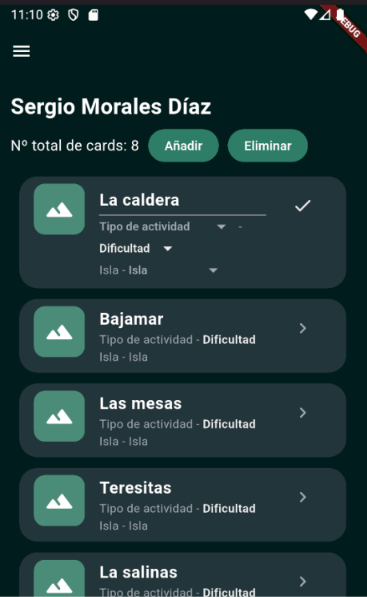
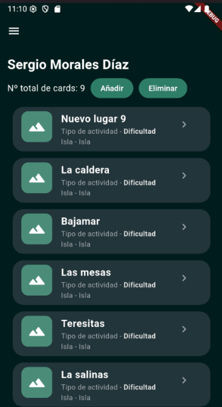
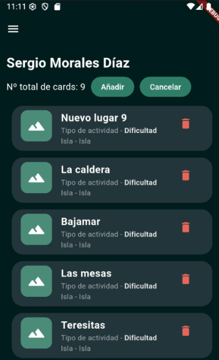

# ud2_t2_usr3498_navegacion

Proyecto de flutter con al integracion de la pantalla home.

Luego hemos añadido la navegación.

y posteriormente hemos integrado la navegacion con las dos pantallas de la tarea ud2 t1.
 

Aqui tenemos la pagina de CRUD:

Luego aqui la tenemos editando una nueva card:

Luego al añadir una la plantilla es asi:

Y el modo de eliminación:
